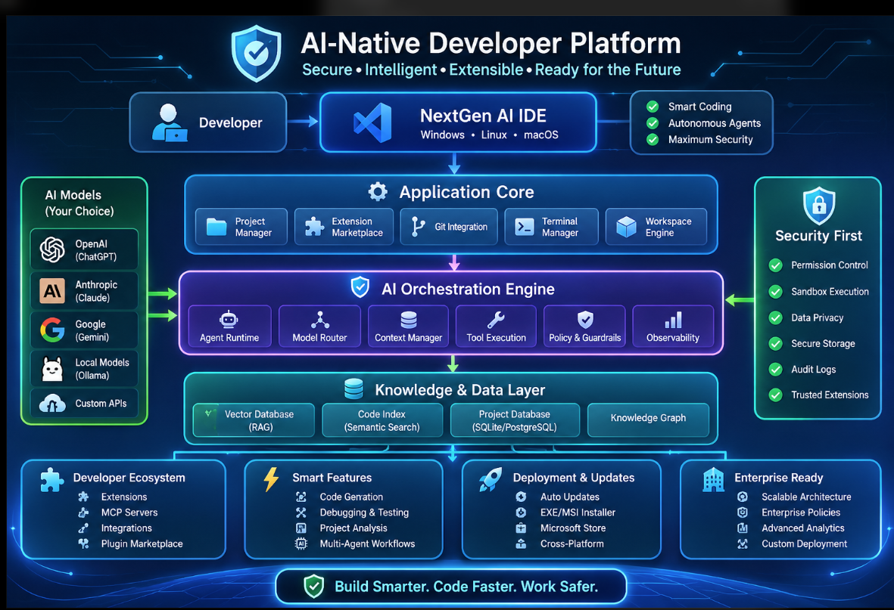
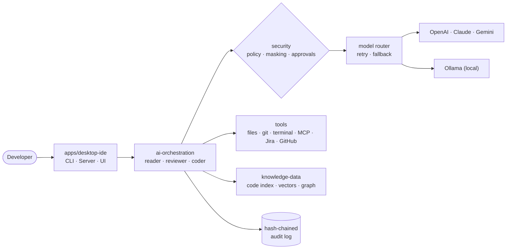

<div align="center">

# AI-Native Developer Platform

**Secure · Intelligent · Extensible**

An open, security-first platform for building AI-powered developer tools.<br>
Multi-model routing, autonomous agents, code intelligence and enterprise controls, ready to use in any project.


[](https://github.com/gauravgupta0612/ai-native-dev-platform/actions/workflows/ci.yml)
[](https://www.npmjs.com/package/@gauravgupta0612/ai-native-common)
[](https://jitpack.io/#gauravgupta0612/ai-native-dev-platform)



</div>

---

## Why this platform?

Most AI coding tools lock you into one model, send your code anywhere, and give you little control. This platform takes a different approach:

| | What you get |
|---|---|
| **Any model, one API** | OpenAI, Anthropic Claude, Google Gemini, local models through Ollama, or your own gateway. Route each task to the best model, with automatic retry and fallback. |
| **Your data stays yours** | Questions containing card numbers, phone numbers, keys or other sensitive data are **automatically kept on the local model**. API keys and secrets are masked before anything leaves your machine. |
| **Agents that are safe to run** | Agents read, search and analyze code by themselves. Writing files and running commands **always need your approval**. Budgets stop runaway loops and costs. |
| **Understands your code base** | Semantic code search, a symbol index (TypeScript, Java, Python, **IBM i RPG**) and a knowledge graph that answers *"what breaks if I change this?"*. |
| **Enterprise-ready from day one** | Layered policies (organization → project), a tamper-evident audit log, an encrypted key vault, signed extensions, usage and cost reports, and an air-gapped mode. |
| **Extensible** | MCP servers, a plugin SDK, Jira and GitHub tools, and custom tools in a few lines. |
| **Zero runtime dependencies** | Only Node.js, Java or Python standard libraries, so there is less supply-chain risk and it is easy to audit. |
| **Three languages** | The shared `common/` library exists in **TypeScript, Java and Python**, with the same design, so every team can use it. |

---

## Quick start (2 minutes)

You need **Node.js 22 or newer** and **git**.

```bash
git clone https://github.com/gauravgupta0612/ai-native-dev-platform.git
cd ai-native-dev-platform

npm install
npm test                                  # builds everything and runs the test suite
npm start -- /path/to/your/project        # opens the interactive AI shell on your project
```

Windows users can run `.\scripts\setup.ps1` (Linux/macOS: `./scripts/setup.sh`) to check Node, create `.env` and run the tests in one step.

**No API key yet?** It still works: the platform falls back to a local Ollama model if one is running, otherwise to an offline `echo` model so you can explore every feature.

### Add your model keys

```bash
cp config/.env.example .env      # Windows: copy config\.env.example .env
```

```env
ANTHROPIC_API_KEY=...
OPENAI_API_KEY=...
GEMINI_API_KEY=...
OLLAMA_ENABLED=true               # optional: local model for sensitive data
```

`.env` is in `.gitignore`. Never commit keys; `npm run scan-secrets` checks for leaks.

---

## Using the AI shell

```text
$ npm start -- ~/projects/orders-service

AI-Native Developer Platform — project "orders-service" (java-maven)
Providers: anthropic, openai, ollama, echo
Policy: file writes allowed (with approval), local only false. Type "help".

> index
Indexed 412 files into 1 380 chunks; 2 115 symbols.

> ask Where is the invoice tax calculated and who calls it?
TaxService.calculate() in src/main/java/.../TaxService.java:42 is called by
InvoiceBuilder (line 88) and RefundService (line 131) ...
[completed · 4 steps · 3 tools · 6 820 tokens]

> code Add rounding to 2 decimals in TaxService.calculate
⚠  coder-agent wants tool:write_file (src/main/java/.../TaxService.java)
   [o]nce / [a]lways / [N]o: o
```

| Command | What it does |
|---|---|
| `ask <question>` | Answers questions about your code (read-only *reader* agent) |
| `review <what>` | Reviews code or changes for bugs, security and readability |
| `code <task>` | Implements a change. Every file write asks for your approval |
| `flow <name> <input>` | Multi-agent workflow: `plan-implement-review` or `bug-triage` |
| `index` | Builds the semantic code index and knowledge graph |
| `analyze` | Languages, size, largest files, TODOs, dependencies, findings |
| `test` | Runs your tests (npm, Maven, Gradle, pytest) and explains failures |
| `open <file>` | Adds a file to the AI context |
| `providers` | Calls, errors, latency, tokens and cost per model |
| `audit` | Verifies the audit log has not been altered |

---

## Use it in your own code

### Whole platform (TypeScript)

```ts
import { createPlatform } from "./apps/desktop-ide";

const platform = await createPlatform({
  projectRoot: "/path/to/project",
  prompt: async (who, permission, detail) => (await confirmInYourUi(who, permission, detail)) ? "allow-once" : "deny",
});

await platform.reindex();
const answer = await platform.agents.ask("reader", "Explain the checkout flow", platform.project);
console.log(answer.output, answer.usage);
```

Multi-agent workflow:

```ts
import { WorkflowEngine, WORKFLOWS } from "./features/multi-agent-workflows";

const run = await new WorkflowEngine(platform.agents).run(WORKFLOWS["plan-implement-review"], "Add CSV export to the report page");
console.log(run.outputs.review);
```

### Install the shared library from a package manager

| Ecosystem | Install |
|---|---|
| **npm** (TypeScript / JavaScript) | `npm install @gauravgupta0612/ai-native-common` |
| **Maven / Gradle** (Java 17+) via [JitPack](https://jitpack.io/#gauravgupta0612/ai-native-dev-platform) | `com.github.gauravgupta0612:ai-native-common:v0.2.0` with the repository `https://jitpack.io` |
| **pip** (Python 3.9+) | `pip install "git+https://github.com/gauravgupta0612/ai-native-dev-platform.git@v0.2.0#subdirectory=common/python"` |

Full instructions, including Maven XML, Gradle and `requirements.txt`, are in [common/README.md](common/README.md#install-it-in-your-own-project).

### Only the shared library: TypeScript, Python or Java

`common/` works on its own in any project. Install it with npm, Maven/Gradle or pip as shown above.

<details>
<summary><b>TypeScript</b></summary>

```ts
import { AgentRuntime, ToolRegistry, createRouter, createWorkspaceTools, loadConfig, loadDotEnv } from "@gauravgupta0612/ai-native-common";

loadDotEnv();
const router = createRouter(loadConfig());
const tools = new ToolRegistry().registerAll(createWorkspaceTools("."));
const result = await new AgentRuntime({ router, tools }).run("Summarize this repository");
```
</details>

<details>
<summary><b>Python</b></summary>

```python
from ai_native_common import AgentRuntime, ToolRegistry, create_router, create_workspace_tools, load_config, load_dotenv

load_dotenv()
router = create_router(load_config())
tools = ToolRegistry().register_all(create_workspace_tools("."))
print(AgentRuntime(router, tools=tools).run("Summarize this repository").output)
```
</details>

<details>
<summary><b>Java</b></summary>

```java
ModelRouter router = PlatformFactory.createRouter(PlatformConfig.load());
ToolRegistry tools = new ToolRegistry().registerAll(WorkspaceTools.create(Path.of(".")));
System.out.println(new AgentRuntime("demo", router).tools(tools).run("Summarize this repository").output());
```
</details>

Step-by-step guides: [TypeScript](common/typescript/README.md) · [Python](common/python/README.md) · [Java](common/java/README.md)

### Server mode (for CI, web apps, chat bots)

```bash
npm run hash-key                                 # prints a new client key and its hash
PLATFORM_API_KEY_HASHES=<hash> npm run serve     # http://127.0.0.1:8787

curl -X POST http://127.0.0.1:8787/v1/agents/reviewer/ask \
  -H "Authorization: Bearer <key>" -H "Content-Type: application/json" \
  -d '{"question":"Review the latest changes in src/payments"}'
```

Includes API-key auth (only hashes are stored), rate limiting, body size limits and security headers. Docker: `enterprise/custom-deployment/docker-compose.yml` (server plus local Ollama).

---

## How it works



1. You ask a question. The **data-privacy** check classifies it; sensitive questions go only to the **local** model.
2. The **context builder** adds open files and the most relevant code chunks from the **code index**.
3. The **agent** calls the model. The model can call **tools** (read files, search code, impact analysis, git, tests).
4. Every tool call is **policy-checked**. Risky ones (write, run) wait for your **approval**, and every action is **audited**.
5. Answers, tokens and costs are recorded locally for **analytics** (no prompts or code are stored).

---

## Security by design

| Threat | Protection |
|---|---|
| API keys leaking to models or logs | Keys, tokens, JWTs and private keys are masked before sending and in every log line |
| Keys sent over plain HTTP | HTTPS enforced (plain HTTP only for localhost); redirects refused |
| Sensitive data going to the cloud | PII and secret detection routes such questions to the local model; `localOnly` and air-gapped modes |
| Agent changing or deleting things | Deny by default; writes and commands need approval; role-based tool sets |
| Agent escaping the project | File tools locked to the project; `../`, absolute paths, symlinks and `.env`/key files blocked |
| Command injection | No shell, allow-listed programs, metacharacters refused, secrets removed from the environment, timeouts |
| Prompt injection in files or web pages | Suspicious tool output is flagged, wrapped as untrusted data, logged and audited |
| Malicious extensions or updates | Ed25519 signatures and SHA-256 checks for extensions and updates; permission-scoped plugin API |
| Audit trail edited afterwards | SHA-256 hash chain; `verifyFile()` finds the first altered line |
| Runaway agents and cost | Step, tool-call and token budgets; per-provider cost tracking |
| Secrets at rest | Encrypted vault (AES-256-GCM, scrypt key) or environment variables |

Details: [common/SECURITY.md](common/SECURITY.md). Organization rules: `config/policy.json` (see `enterprise/enterprise-policies/policy.example.json`).

---

## Configuration

| File | Purpose |
|---|---|
| `.env` | API keys and local settings (never committed) |
| `config/routing.json` | Enabled providers, default model, which task goes to which model, retries |
| `config/policy.json` | Organization policy: allowed tools and commands, file writes, budgets, blocked patterns |
| `<project>/.aiplatform/policy.json` | Per-project policy; it can only make the organization policy **stricter** |
| `ecosystem/mcp-servers/mcp-servers.example.json` | MCP servers to connect |

Deployment profiles in `enterprise/custom-deployment`: **cloud**, **hybrid** (sensitive data stays local), **on-prem** (company gateway plus local) and **air-gapped** (local models only, no network features).

---

## Project structure

```text
apps/desktop-ide      Platform bootstrap, interactive CLI, HTTP server
core/                 Projects · workspace · git · terminal (sandboxed) · extension marketplace
ai-orchestration/     Agents · model router · context (RAG) · tool sets · policy · telemetry
model-providers/      OpenAI · Anthropic · Gemini · Ollama · custom APIs · cost catalogue
knowledge-data/       Vector store · code index · project database · knowledge graph
security/             Permissions · sandbox · data privacy · secure storage · audit log · extension trust
ecosystem/            MCP client · Jira and GitHub · plugin SDK · sample extension
features/             Code generation · debug and test · project analysis · multi-agent workflows
deployment/           Signed auto-update · Windows/Linux/macOS installers · Microsoft Store
enterprise/           Policies · analytics · server mode · deployment profiles
common/               Shared library in TypeScript, Java and Python
config/ scripts/ tests/ docs/
```

Every folder has its own README with its purpose and main exports.

---

## Extend it

| You want to… | Do this |
|---|---|
| Add a model or gateway | Implement `ModelProvider` (`name` + `chat()`), or use `createCustomOpenAICompatible()` for OpenAI-compatible APIs |
| Give agents a new ability | Register a tool: name, description, JSON schema, handler. Set `requiresApproval` for anything risky |
| Connect MCP servers | Configure `mcp-servers.json`, then pass the tools from `startMcpServers()` as `extraTools` |
| Ship an extension | `extension.json` plus `main.js` (see `ecosystem/extensions/hello-world`), signed with `signExtension()` |
| Add a workflow | Add a `Workflow` to `features/multi-agent-workflows` (steps, roles, prompt templates) |

---

## Tests

```bash
npm test                                               # platform: unit + end-to-end tests
cd common/typescript && npm install && npm test        # shared library (TypeScript)
cd common/python && python -m unittest discover -s tests
cd common/java && mvn test
```

Tests run offline with scripted models. No API keys or network are needed.

---

## Status and roadmap

| Status | Item |
|---|---|
| ✅ | Core platform, agents, security layer, knowledge layer, enterprise features, CLI and server mode |
| ✅ | Shared library in TypeScript, Java and Python |
| 🚧 | Graphical desktop UI (Electron / VS Code extension) on top of `createPlatform()` |
| 🚧 | Streaming responses and native Gemini tool calling |
| 🚧 | SQLite/PostgreSQL and pgvector adapters for large code bases |
| 🔍 | Installer scripts and live provider calls need validation on each target environment |

Ideas and pull requests are welcome.

---

## Contributing

1. Fork the repository and create a branch: `git checkout -b feature/my-change`
2. Keep changes small and covered by tests: `npm test`
3. Make sure no secrets are committed: `npm run scan-secrets`
4. Open a pull request describing what and why

## License

MIT. See [LICENSE](LICENSE).

<div align="center"><sub>Built by <a href="https://github.com/gauravgupta0612">@gauravgupta0612</a> · Build smarter. Code faster. Work safer.</sub></div>
